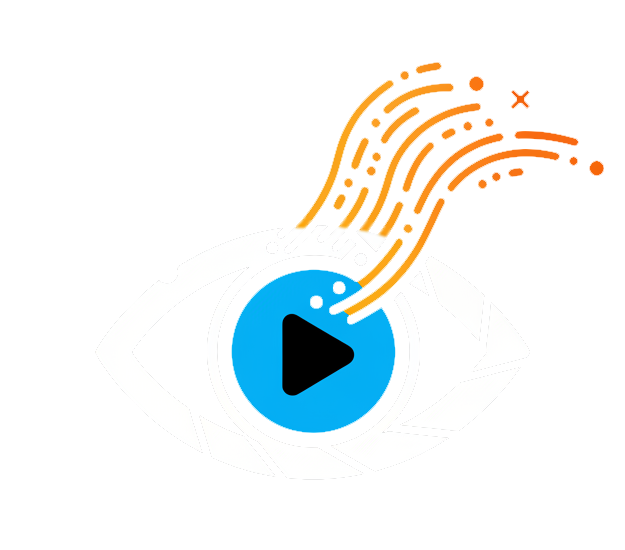
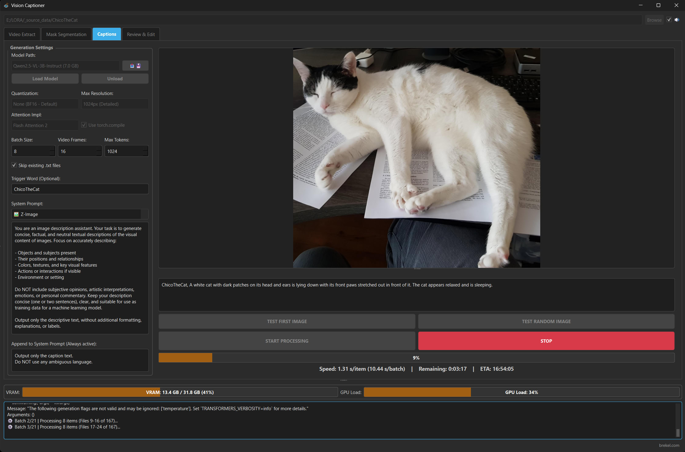

# VisionCaptioner（中文增强版）

<p align="center">
  
</p>

**VisionCaptioner** 是一款本地桌面应用，用于为图片/视频数据集批量生成 AI 训练用的高质量描述（打标）。

专为训练自定义模型（LoRA / 微调 / Flux / Z-Image Turbo / Qwen-Image / SDXL / Wan / HunyuanVideo 等）的 AI 研究者和爱好者打造，基于 **Qwen-VL** 和 **Google Gemma 4** 系列视觉语言模型生成上下文感知的批量描述。



本仓库基于 [Brekel/VisionCaptioner](https://github.com/Brekel/VisionCaptioner) 原版项目，**不改动任何源码**，外挂了以下增强：

*   **🇨🇳 全界面中文汉化**：外挂启动器（`launcher.py`）在运行时拦截 Qt 文本渲染，词典驱动、随开随用，不修改项目源码。想用回英文原版随时可切。
*   **🚀 ModelScope 双源下载**：模型管理器新增"下载源"选择器（自动 / 仅 ModelScope / 仅 HuggingFace），国内下载无需梯子，速度大幅提升。
*   **📦 Windows 绿色便携版**：支持内嵌 Python 运行时打包，解压即用、免安装，适合分发给无 Python 环境的用户（见下方说明）。

## 环境要求

| 项目 | 要求 |
|---|---|
| 操作系统 | Windows 10/11 64 位，或 Ubuntu 22.04 |
| 显卡 | NVIDIA GPU，**驱动 ≥ 560**（CUDA 12.6 兼容线） |
| Python | 3.12（由 uv 统一管理，无需手动安装） |
| 包管理 | [uv](https://docs.astral.sh/uv/) |
| VC++ 运行库 | 仅 Windows：需已安装 **VC++ 2015-2022 x64**（多数系统自带，缺失时见下方说明） |

> ⚠️ **CUDA 版本注意**：本项目统一使用 **cu126** 版 PyTorch。驱动低于 560 时请先升级驱动；**不要改用 cu130**——旧驱动上会导致 GPU 访问违例闪退（`c10_cuda.dll 0xc0000005`）。
>
> 原版项目还支持 AMD ROCm 与 Apple Silicon，本仓库的安装流程仅在 NVIDIA + CUDA 12.6 上验证过。

> ⚠️ **Windows 需安装 VC++ 运行库**：PyTorch 依赖 [Microsoft Visual C++ 2015-2022 Redistributable (x64)](https://aka.ms/vs/17/release/vc_redist.x64.exe)。多数 Win10/11 已自带；若缺失（典型症状：启动闪退且无任何报错，精简系统 / 云电脑如 Windows Server 2022 尤其常见），请从上方链接下载安装后重新启动。

## 安装（基于 uv）

先安装 uv：

*   **Windows**：`powershell -ExecutionPolicy ByPass -c "irm https://astral.sh/uv/install.ps1 | iex"`
*   **Linux**：`curl -LsSf https://astral.sh/uv/install.sh | sh`

### Windows

```bash
git clone <本仓库地址>
cd VisionCaptioner

# 1. 创建虚拟环境（只需一次）
uv venv venv --seed --python 3.12

# 2. 安装 CUDA 12.6 版 torch（注意 --python 指向 venv）
uv pip install --python venv\Scripts\python.exe torch torchvision --index-url https://download.pytorch.org/whl/cu126

# 3. 安装其余依赖
uv pip install --python venv\Scripts\python.exe -r requirements.txt
```

### Ubuntu 22.04

一条命令完成"创建环境 + 装依赖 + 中文启动"：

```bash
bash run_cn.sh
```

或与 Windows 一致的手动流程：

```bash
git clone <本仓库地址>
cd VisionCaptioner
uv venv venv --seed --python 3.12
uv pip install --python venv/bin/python torch torchvision --index-url https://download.pytorch.org/whl/cu126
uv pip install --python venv/bin/python -r requirements.txt
```

Linux 注意事项：

*   纯 SSH 终端跑不了 GUI，需要桌面 / VNC 环境；若只需批量打标，可直接用命令行模式（见下方 CLI 章节）。
*   部分系统需要安装 Qt 依赖：`sudo apt install libxcb-cursor0 libxcb-xinerama0 libxcb-icccm4 libxcb-image0 libxcb-keysyms1 libxcb-randr0 libxcb-render-util0 libxcb-shape0 libxcb-xfixes0 libxcb-xkb1 libxkbcommon-x11-0`

## 启动

| 入口 | 平台 | 说明 |
|---|---|---|
| `run_cn.bat` | Windows | **中文界面**（推荐），外挂汉化启动 |
| `run_cn.sh` | Linux | **中文界面**，首次运行自动初始化 uv 环境 |
| `run.bat` / `run.sh` | Win / Linux | 英文原版界面 |
| `run_portable.bat` | Windows | 绿色便携版启动，需项目内含 `runtime\` 文件夹（仅随 zip 分发包提供，**git clone 不包含**，请走上面的 uv 安装流程） |

汉化相关：

*   首次使用可自检汉化钩子：`python launcher.py --selftest`
*   临时切换英文：`python launcher.py --en`
*   未翻译词条会自动收集到 `i18n/pending.json`，翻译后并入 `i18n/zh_CN.json` 即可生效

## 模型下载

*   在打标页的模型管理器（📥 按钮）中下载，**下载源**支持：
    *   **自动**（默认）：优先 ModelScope，失败自动回落 HuggingFace
    *   **仅 ModelScope** / **仅 HuggingFace**：强制指定
*   模型统一存放在项目目录 `models/` 文件夹下，每个模型独立子文件夹；GGUF 模型可手动放入后用"扫描本地模型"发现（多模态 GGUF 需配套 mmproj 文件，详见 [readme_models.md](readme_models.md)）。

### 各模型下载源一览

| 模型 | ModelScope | HuggingFace | 备注 |
|---|:---:|:---:|---|
| SAM3（蒙版分割用） | ✅ | ⚠️ 需 Token | HF 上为 Gated 模型，**ModelScope 免 Token** |
| Qwen2.5-VL-3B / 7B-Instruct | ✅ | ✅ | |
| Qwen3-VL-2B / 4B / 8B / 32B-Instruct | ✅ | ✅ | Qwen 官方双源 |
| Qwen2.5-VL-3B / 7B-Abliterated | ✅ | ✅ | huihui-ai 已入驻 ModelScope |
| Qwen3-VL-2B / 4B / 8B-Abliterated | ✅ | ✅ | 走 ModelScope 镜像（fireicewolf） |
| Qwen2.5-VL-7B-Caption-It | ❌ | ✅ | **仅 HF 可下** |
| Qwen3-VL-32B-Abliterated | ❌ | ✅ | **仅 HF 可下**，需 24GB+ 显存 |
| Gemma-4 全系（E2B / E4B / 26B-A4B / 31B） | ✅ | ✅ | |

> 总结：**18 个模型中 16 个可走 ModelScope**，仅 2 个 Abliterated 衍生版只有 HF 源（"自动"档会自动回落到 HuggingFace，无需手动切换）。国内用户保持默认"自动"即可全程高速下载。

## 低显存（8GB）使用建议

*   批处理大小（Batch Size）从 **1** 起步，跑通后再尝试 2。
*   量化选 **NF4 (4-bit)**：Qwen3-VL-4B + NF4 可舒适运行在 8GB 显存上。
*   优先考虑 Qwen3-VL-2B / 4B；SAM3 与打标模型**不要同时加载**。
*   显示器若接在独显上，Windows 桌面会额外占用约 1GB 显存。

## 功能总览

*   **打标（Captions）**：Qwen-VL / Gemma 4 批量生成图片和视频描述，支持触发词注入、跳过已有描述、系统提示词预设、分辨率与量化调节、GGUF 模型（详见 [readme_captions.md](readme_captions.md)）
*   **审查编辑（Review & Edit）**：快速浏览和手动编辑数据集描述，含查找替换与常用预设
*   **蒙版分割（Mask Segmentation）**：基于 SAM3 的提示式主体分割，可视化蒙版编辑器，支持多种蒙版格式，兼容 [OneTrainer](https://github.com/Nerogar/OneTrainer)（详见 [readme_mask_segmentation.md](readme_mask_segmentation.md)）
*   **视频抽帧（Video Extraction）**：从包含指定主体的视频中智能抽取帧
*   **质量检查（Quality Assurance）**：模糊/分辨率/人脸眼部检测/缺失蒙版分析，加权评分排序与批量处理
*   **完全本地执行**：数据不出本机，隐私可控
*   **命令行接口**：支持脚本化批量处理，自动读取 GUI 保存的 `settings.json`，详见 [commandline_interface.md](commandline_interface.md)

## 更新

```bash
git pull
uv pip install --python venv/Scripts/python.exe --upgrade -r requirements.txt   # Windows
uv pip install --python venv/bin/python --upgrade -r requirements.txt           # Linux
```

（原版自带的 `update.bat` / `update.sh` 亦可使用。）

## 致谢

*   **[Brekel (Jasper Brekelmans)](https://brekel.com)** — [原版 VisionCaptioner](https://github.com/Brekel/VisionCaptioner) 作者
*   阿里云 Qwen 团队 — [Qwen-VL 系列模型](https://github.com/QwenLM/Qwen3-VL)
*   Google DeepMind — [Gemma 4](https://huggingface.co/google) 系列多模态模型
*   Meta AI — [Segment Anything Model 3 (SAM3)](https://github.com/facebookresearch/sam3)

如果这个工具对你有帮助，欢迎给原版项目点一个 ⭐：[https://github.com/Brekel/VisionCaptioner](https://github.com/Brekel/VisionCaptioner)
