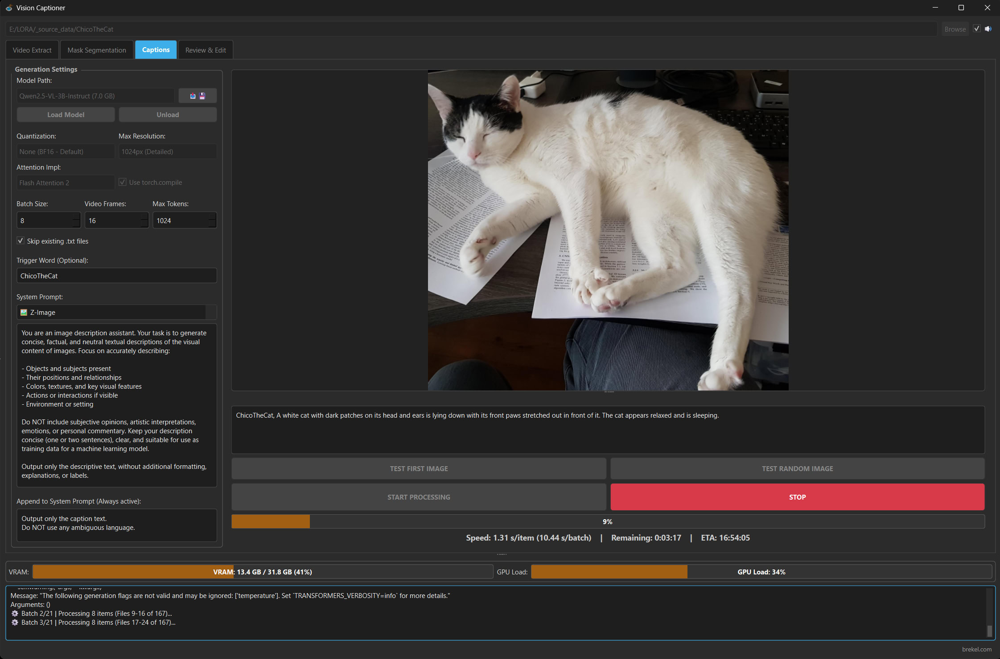

# Captions tab

The Captions tab is used to generate captions for images and videos.

## General Use ##
* First select a folder with images or videos to process at the top of the window.

* To get started make sure to select a model from the dropdown menu and hit "Load Model".
Models can be downloaded using the built-in downloads manager on the Captions tab (📥💾 button), more info in the [readme_models.md](readme_models.md) file.

* Select a "System Prompt" from the dropdown menu or use the "Custom" option to enter your own system prompt.
* Set any other options as desired (they all have tooltips to explain what they do).
* Hit "TEST FIRST IMAGE" or "TEST RANDOM IMAGE" to test on a single image.
* Hit "START PROCESSING" to process all images in the selected folder.

In your output folder you will find a .txt file for each image/video with the generated caption.

## Optimizing Speed ##
* Although a single image can be a bit slow (ranging from a few seconds to tens of seconds)
* Increasing the "Batch Size" will allow multiple images to be processed at once, experiment by raising this value to as high as your VRAM allows
* Lowering precision and/or selecting a different attention implementation and/or torch compile may increase speed (only supported for non-GGUF models)
* Some GGUF models may be faster as well, but require manual downloading and installation of the llama-cpp-python package, see above for instructions. This is for more advanced users.

## Customizing System Prompt ##
* System prompt files can be found as text files in the "prompts" folder
* The app checks these at startup
* You can select a predefined prompt from the list
* Or you can use the "Custom" setting and type your system prompt in the app
* Or create/edit the text files in the "prompts" folder

## Folder path context / 文件夹路径上下文 ##

Enable **Include folder path as context** (中文界面：**将文件夹路径作为上下文**) below the prompt box to supply each image/video's full containing-folder path as external metadata. The filename is excluded; all parent folder levels are retained. This option is off by default and saved with GUI settings. It applies to single-image tests and batch captions, for local models and online APIs. With an online API, the path is included in the request to your selected provider.

The program does not assign meanings to folder names or automatically add them to captions. Explain their meaning and desired use in your prompt. For example: “Use the product category and color from the folder names as supplied metadata; describe other details from the image. Do not output the full path.” A visual-only prompt should explicitly allow the metadata you want to use. No placeholder syntax is needed. If your images are nested, also enable **Include subfolders**.

中文使用：勾选开关后，程序逐张传入所在文件夹的完整路径，不固定提取分子量、孔数或其他字段。请在提示词中明确哪些目录信息可以用于标签。例如：“路径中带 kDa 的文件夹名称是目录标称目标分子量，请保留该信息；实际可见泳道数按图片判断，不照抄目录孔数。不要输出完整路径。”重新启动程序后可看到新增开关。

CLI: `--include-folder-context` enables this option and `--no-include-folder-context` disables it, overriding the saved GUI preference.

## Model Families ##
VisionCaptioner supports two Vision-Language Model families:

* **Qwen-VL** (Qwen2.5-VL, Qwen3-VL) — controlled by the "Max Resolution" dropdown.
* **Google Gemma 4** (E2B, E4B, 26B-A4B, 31B) — controlled by the "Vision Tokens (Gemma)" dropdown, which sets the soft visual token budget per image (70, 140, 280, 560, or 1120). Higher = more detail, slower, more VRAM. The "Max Resolution" setting is ignored for Gemma.

The correct settings panel becomes active automatically when you pick a model from the dropdown. Gemma 4's built-in "thinking" reasoning mode is automatically disabled for captioning.

See [readme_models.md](readme_models.md) for the full list of supported models and download links.
